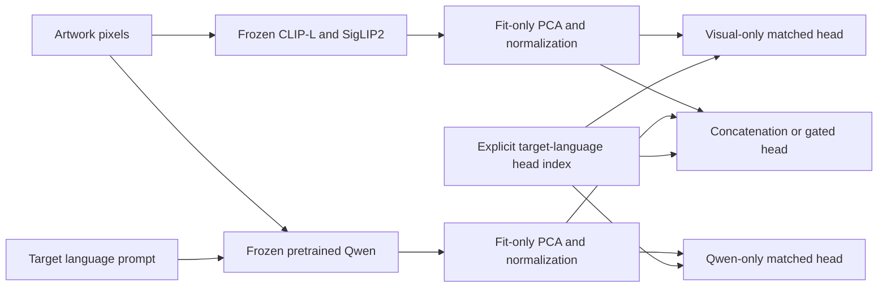
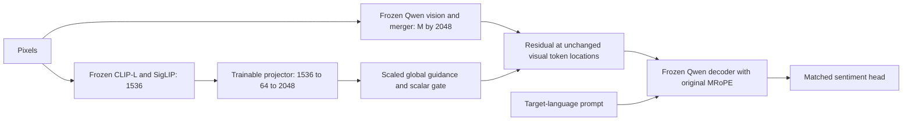

# EXP-028 — CLIP-guided Qwen design proposal

**EXP028 = DESIGN_PROPOSED / NOT_IMPLEMENTED.** TASK-032 authorizes CPU closure,
cache inspection, documentation and tests only. No feature extraction, head fit,
GPU run, outer scoring, decoder implementation or new architecture exists here.
Production remains E50+L. [Proposed numerical specification](../docs/exp028_design_spec.json)
is a review artifact, not executable configuration or owner authorization.
Existing Qwen research-license/resource competition-eligibility caveats remain
unresolved; checkpoint pins and research permission are not organizer approval.
Any future authorized implementation must retain the shared workflow standard:
one notebook/advance scope authorization/Run all, strict source/input identities,
bounded benchmark and execution, verified completed boundaries, persistent
success/failure export, browser-download attempt and runtime release. Do not
build or retrofit that execution pipeline in this design-only task.

## Question and smallest viable first experiment

Can frozen CLIP/SigLIP and Qwen jointly improve held-out Cultural Contrast beyond
the best visual-only model **and** equal-capacity controls? H28-A is nonredundant
representation value; H28-B is improved decoder conditioning by guided visual
tokens. Test H28-A before spending substantial resources on H28-B.

**First recommendation:** complete the existing Drive frozen-state cache audit,
then implement the eight small LR arms below for a preregistered fold3 screen
with fresh training-only projections and matched E50+L refits. This is CPU work
if the caches are complete. No decoder QLoRA or injection. The three gated heads
are specified for the fuller Stage1 comparison but need separate explicit
implementation/execution scope; they are not a reason to delay the cheapest LR
answer. Freeze all arms before outcomes, never add/tune them from outer results.
If Qwen fails to add held-out value beyond A512/A_raw and E50+L, stop/review rather
than automatically building Stage2. A better Qwen-only score is not sufficient.

TASK-031 supports investigating usefulness/alignment of an existing interaction
pathway. It does not establish complementary representations, identify a unique
causal defect, or show that CLIP guidance will help. H4 (3B capacity insufficient)
remains distinct and untested; no larger/newer-model search is proposed for execution.

## Stage1 representations: expensive encoders frozen

- `V(I)=[unit(CLIP-L_768),unit(SigLIP2-Base_768)]/sqrt(2)` (1536). Existing
  pinned revisions: CLIP-L `32bd64288804d66eefd0ccbe215aa642df71cc41`, SigLIP2
  `75de2d55ec2d0b4efc50b3e9ad70dba96a7b2fa2`. CLIP-B is reused for E50+L only,
  revision `3d74acf9a28c67741b2f4f2ea7635f0aaf6f0268`.
- `Q(I,l)` is the2048-dimensional final decoder state from the original target-
  language prompt under the pinned **pretrained frozen NF4 Qwen with adapters
  disabled**, revision `66285546d2b821cf421d4f5eb2576359d3770cd3`. No caption
  generation, vote input or fitted EXP-026/027 adapter. Normalize Q to unit length.
- Q is **image-and-target-language conditioned**, not an image-only vector.
  Cache/join by pixel SHA plus exact prompt language and extractor identity;
  never silently reuse Q(I,a) for Q(I,b). Neutral-prompt Q(I,neutral) is a distinct
  optional diagnostic, not the primary representation or a prompt-search arm.
- PCA is unwhitened, fit separately on the applicable fitting split only, with
  deterministic eigensolver sign convention. V uses one row per painting. Q's
  weighted covariance gives each painting total weight1 across its language rows;
  no vote/label weighting enters feature transforms. Center using fit-only means,
  retain256 components, then unit-normalize each projected block. Fail zero norms,
  rank<256 or ambiguous keys instead of changing dimensions.512-dimensional
  unimodal controls use independent train-only PCA512 and must have rank≥512.
  No global centering/PCA across outer-held paintings. An unseen language uses
  its literal target-language prompt and the shared regression term, with zero
  language residual; never map it to another community.

## Controlled ablation matrix and parameter accounting

All linear arms use the original annotator-count-weighted Model C objective,
features `[x,onehot(l),x outer onehot(l)]`, L2-regularized logistic regression,
lbfgs/max_iter3000. With L=25: `(L+1)*d+L+1` fitted scalars, including intercept.
PCA parameters are **fit transforms**, separately reported, not trained sentiment
parameters; their capacity is controlled by the512-dimensional unimodal arms.
Language vocabulary comes from fitting data only; counts below assume all25.

| Arm | Features /d | Fitted LR scalars | Purpose |
| --- | --- | ---: | --- |
| A_raw | V /1536 |39,962|Requested CLIP/SigLIP Model C-style reference|
| B_raw | Q /2048 |53,274|Matched Qwen regression; raw width caveat|
| A256 | PCA256(V) /256 |6,682|One-block visual control|
| B256 | PCA256(Q) /256 |6,682|One-block Qwen control|
| A512 | PCA512(V) /512 |13,338|Same feature width/parameter budget as fusion|
| B512 | PCA512(Q) /512 |13,338|Same feature width/parameter budget as fusion|
| C512 | concat(A256,B256)/sqrt(2) /512 |13,338|Primary complementary-representation test|
| C512 shuffled Q | Same /512 |13,338|Counterfactual information control; never deploy|

Shuffle Q rows with a fixed seed28028, separately **within each language and each
fit/stop/outer partition**, keeping V/targets fixed. Use a deterministic cyclic
permutation of a hash-ranked painting list, no fixed points for groups of size≥2;
singletons stay unchanged and are counted. This preserves coverage/marginals but
breaks image correspondence and cross-language painting coherence. It is an OOD
diagnostic, not a valid inference method or causal estimator. Do not transfer a
training/validation/held-out row across partitions to fill a missing feature.

For each LR arm choose C from `{0.1,0.3,1.0}` by **inner vote-weighted BCE**, ties
to smaller C. Same candidate list, fitting/stopping paintings, seed2027 and solver
limits for every arm; require convergence. Never choose C from outer Contrast.
R0 is the original fixed-C0.3 E50+L formula, not a searched blend.

Proposed lightweight nonlinear comparison: map each256 block through its own
Linear256→64 +GELU +dropout0.2; gate
`g=sigmoid(Linear([hV,hQ,language_embedding_8]))`; fuse `g*hV+(1-g)*hQ` and use
the shared scalar +language bias +64-wide language interaction sentiment head.
No hidden text supervision, auxiliary loss or trainable vision encoder.

| Arm | Two input streams | Trainable scalars at L25 |
| --- | --- | ---: |
| D_VQ | V256,Q256 |34,923|
| D_VV | V256,V256, independent projectors |34,923|
| D_QQ | Q256,Q256, independent projectors |34,923|

Count:2×(256×64+64)+25×8+(128+8+1)+(64+1)+25+25×64.
These controls give equal nonlinear head/parameter capacity; comparing D only
against LR cannot attribute a gain to complementary representations. Proposed
common optimization: AdamW lr1e-3/weight_decay0.01, clip1.0, effective4 painting
groups, original vote-weighted BCE over all language rows, max50 epochs/patience5,
earliest minimum inner BCE. Seeds2027/2028/2029, identical initialization/order
across D arms; select epochs separately, reset/refit on all outer-training
paintings for the selected count. No score-based learning-rate or gate search.
Average three seed probabilities with fixed six-decimal prediction conventions;
report individual seeds too. A/B/C and D comparisons have different head families;
the matched controls **within** each family carry the complementarity claim.

## Data, selection and reused-development evaluation

Use checksum-pinned original P2:1335 paintings,13,600 eligible pairs,25 languages,
exact original five painting-grouped folds. Names locate images; no artist/style
or filename enters predictive features. Require≥5 binary-mappable votes; no
ambiguous labels, captions, generated text or external annotations. All images,
row keys and input eligibility are identical across arms. Vote weights n belong
to training loss only; predictions depend solely on pixels and target language.

For each outer fold, reproduce existing inner90/10 painting split with
`early_stop_seed17029+fold`, original `image_sha256` grouping and ceil10% stopping
rule. Fit PCA/normalizers, regularization, epochs and heads using only the inner
fitting population and stopping labels. Refit transforms/heads freshly on the
complete outer-training population with selected C/epochs; evaluate outer once.
LR/full-refit and D/full-refit models consequently use identical fitting
paintings. No EXP-026/027 fitted adapter or fitted full-P2 transform is reusable.

Controlled R0_inner and R0_refit: refit the original three frozen-feature LR heads
on the exact corresponding populations, C0.3, formula
`0.25*CLIP-B +0.25*SigLIP2 +0.5*CLIP-L`, preserving original nested six-decimal
rounding. Verify full-refit parity with the checksum-pinned P2 R0 OOF reference
when its provenance demonstrates identical folds/populations. Otherwise keep
historical R0 as an **external fixed reference**, identify the discrepancy and use
the matched refit for controlled conclusions; do not edit historical predictions.
Historical EXP-026/027 scores on smaller populations are context only.

First screen uses fold3 (267 outer paintings,1068 before inner split); this is
reused exploratory evidence. All P2 folds have been examined previously, including
fold3 historically; neither nested splitting nor bootstrapping makes them untouched
confirmation. Full5-fold analysis requires another explicit execution scope.
Architecture/C/epoch/gate decisions from this screen must never be described as
independently validated on these same paintings. Keep236 confirmation paintings'
annotations sealed; no Development scoring or automatic submission/promotion.

Use existing `st3.metrics` public-specification reconstruction: within-painting
Pearson over≥3 eligible languages, exclude constant gold, constant prediction→0;
mean eligible paintings. Macro Log Loss uses base2, q clipped[0.01,0.99], binary
vote proportions per pair, unweighted pair mean within each language, then macro
over languages with≥20 pairs. Do not substitute global vote-weighted loss for
that metric; inner selection BCE is a different, explicitly named quantity.
Report fold means and pooled OOF, per-language losses, paired painting wins/losses,
prediction variance,10,000 painting-paired bootstrap intervals seed28029, and
latency/memory/feature-extraction costs. Full-CV bootstrap stratifies by fold.

Model contributions: C/D must beat visual-only **and** Qwen-only controls, their
same-capacity controls and shuffled information. Report C−A, C−B, D_VQ−D_VV,
D_VQ−D_QQ, true−shuffled and candidate−matched R0 on identical populations.
On outer predictions, report predefined within-painting centered alignment and
language-order errors; a hash-selected, label-magnitude-independent rectangle grid
can extend TASK-031's raw D diagnostics. Freeze that grid before inference;
keep it secondary to official held-out metrics, never select large-D examples.

## Cache inventory, missing resources and cost

[CPU inventory receipt](../docs/exp028_feature_inventory.json) verifies existing
CLIP-B, CLIP-L and SigLIP2-Base cache payload SHA, finite arrays and all1335 P2
image keys. Widths512/768/768; maximum P2 unit-norm error1.1921e-7. Archives also
contain other image rows; only P2 images are used, no confirmation annotations.
CLIP-L's1571-row cache is sufficient; no new visual GPU extraction is needed.

Local Qwen cache contains just one vision file, one language state and one neutral
state, with array hashes valid but a **legacy identity missing the current source
fingerprint**. It cannot silently satisfy current cache reuse. Drive directory
`MyDrive/exp026/features/8f1e57257da52d7212b0/` has an identity exactly matching
the frozen extraction source/runtime/prompt. Its first100 file metadata entries
were inspected; **full payload/key coverage and array integrity remain unverified**.
Do not infer1335/13,600 complete states from an identity/folder. TASK-031 raw logits
are not reusable hidden states; EXP-025 caption/text caches are not these features.

Before any GPU request, download/list the entire existing cache, validate every
array SHA/shape/source/pixel/prompt key, and publish exact missing-key counts for
this predefined P2 population. A compatible full cache means **zero GPU forwards**.
Neither manual relabeling of the legacy identity nor partial coverage is allowed.
Missing CPU proofs: all-frozen Qwen state equivalence, row-key joins, fit-only PCA,
weighted grouping, capacity controls and matched R0 parity. These belong to a
separately authorized implementation task, not hidden EXP-028 code here.

Exact **cold** primary coverage bound, computed from label-free P2 keys:

| Operation | Count /storage |
| --- | --- |
| CLIP/SigLIP forwards |0, reuse verified caches|
| Qwen vision forwards |1335|
| Target-language decoder sequences |13,600|
| Decoder batches, painting-grouped ≤8 original pairs/batch |2351|
| Optional neutral diagnostic |1335 extra sequences /batches|
| Q language states FP32 |106.25MiB|
| Optional neutral states FP32 |10.43MiB|
| V fused FP32 |7.82MiB|
| Frozen visual tokens FP16,128–256 tokens/image |about0.65–1.30GiB|

Warm exact forwards equal the missing compatible image and `(image,language)`
keys, plus a preregistered representative parity batch; current remote payload
uncertainty means warm count is **unknown**, not assumed zero. No allocation may
start until it is known. Extraction can be shared across folds because pretrained
encoders see no labels; learned transforms cannot.

TASK-031 saved decoder-batch timings total50.9297s for996 main sequences, about
19.56 sequences/s, while the whole worker took200.24s. This excludes substantial
vision/setup/replay/I/O and has a small intervention-specific workload. It is not
a measured EXP-028 extraction benchmark. Pure decoder extrapolation is about11.6min;
use a conservative2–8 sequences/s planning range (28–113min) **plus** cold
vision/loading/export, roughly0.5–2.5 allocation-hours if fully missing. No budget
is authorized; benchmark representative full painting groups before fixing a cap.

CPU LR matrix peak is estimated2–6GiB RAM depending on sparse copies/raw widths;
512-wide fusion arrays are about53MiB in float64, unwhitened Q covariance32MiB.
Reserve about3GiB disk for reusable frozen tokens/states/receipts. Frozen NF4 L4
inference recorded3.79GiB allocated in TASK-031; plan8GiB free margin, measure a
true8-query cold batch and stop on OOM without precision/token changes. No Stage2
training VRAM is inferred from this inference-only measurement.

Eight LR arms require3 inner C fits +one refit each (32 fits/outer fold), plus six
matched R0 component fits (inner/full). LR heads alone are planned5–15 CPU minutes,
not measured. Proposed gated extension adds18 selection/refit fits per outer fold
(3 arms ×3 seeds ×2 phases), up to50 epochs with early stopping; plan15–45 CPU
minutes provisionally and benchmark before launch. Five-fold expansion multiplies
those head counts by5, **not frozen extraction**; it is not automatic.

## Scientific signals versus promotion

Predeclare C512 as the first LR screen's candidate; report every arm, no outer
architecture/weight tuning. Pilot signal: Contrast≥matched R0+0.003 and ≥strongest
CLIP-only control+0.002, Macro Log Loss≤R0+0.005 bits, complete converged/replayed
fits and no capacity/shuffle contradiction. One reused fold is a resource-allocation
signal, not statistical confirmation or production qualification. Report uncertainty
even if intervals cross0; do not tune away a negative signal on the same paintings.

For separately authorized full reused CV, choose among preregistered methods using
inner criteria, not an outer-fold oracle. Recommend project-consistent promotion
**requirements**: pooled Contrast≥E50+L+0.003 and ≥strongest matched CLIP-only
control+0.002;≥3/5 folds improve; fold-mean Macro Log Loss≤E50+L+0.005; all seeds,
checkpoints and predictions verified. Cost must be justified. These are minimum
requirements, not automatic promotion: reused-CV GO still needs genuine resource
eligibility, separate owner review and any independently authorized confirmation.
A fusion that merely beats Qwen while matching/losing to E50+L fails the competitive
question. No confirmation labels or hosted submission in TASK-032/Stage1.

## Stage2 — decoder guidance, design only and conditional

Only consider H28-B after credible, consistent, capacity-controlled H28-A evidence
and a clear incremental comparison against Stage1 fusion. No decoder implementation
or training is authorized. Keep existing pretrained encoders/checkpoints; initial
guided decoder experiment should freeze Qwen (no LoRA) to isolate the projector;
LoRA would be a separate matched factor requiring a new preregistration.

Pinned Qwen config has a1280-wide visual tower, spatial merge2 and2048-wide merged
visual tokens /decoder states. The installed v4.51.3 visual forward restores token
order after window attention and merging. Preserve that returned order, per-image
grid, image-token counts, masks and multimodal positional indices. These dimensions
come from the [pinned model config](https://huggingface.co/Qwen/Qwen2.5-VL-3B-Instruct/blob/66285546d2b821cf421d4f5eb2576359d3770cd3/config.json);
token ordering/rotary assembly must follow the [pinned Transformers source](https://github.com/huggingface/transformers/blob/v4.51.3/src/transformers/models/qwen2_5_vl/modeling_qwen2_5_vl.py).

| Alternative | Alignment/position implications | Main risk |
| --- | --- | --- |
| Residual after Qwen visual merger |Broadcast projected global V across existing M×2048 tokens, keep original ordering/grid/MRoPE|No spatial CLIP-to-Qwen alignment; scale mismatch or global shortcut|
| Projected visual prefix tokens |Add K learned2048-wide tokens plus masks and defined positions; prefix/image/text positions must be explicitly redesigned|Extra zero embeddings still change softmax attention, so zero prefix is not identity|

Prefer a **residual prototype for the first technical design review**, because it
can preserve sequence positions/counts; this is an engineering choice conditional
on Stage1, not a claim of superior quality. CLIP/SigLIP pooled features have no
patch correspondence, so do not pretend to match individual Qwen spatial tokens.
Prefix tokens remain a meaningful alternative if global broadcast is inadequate,
but need masked-gate identity proofs and longer-sequence memory accounting first.

Concept: `V_guided=V_Qwen + tanh(g)*s*Project(unit(V))`, broadcast over M returned
tokens. Two-layer1536→64→2048 projector has231,488 parameters including biases;
one gate adds1. A single full1536→2048 linear would have3,147,776, motivating the
bottleneck control. Calibrate fixed scale s from training-only token RMS, record
it, and never normalize/overwrite the pretrained V_Qwen path. Initialize gate0
with a nonzero random projector: exact original tokens/outputs at initialization.
Do not zero both factors; projector gradients can be zero at the first step, then
must become nonzero after the gate updates. Compare with parameter-matched
zero/shuffled-guidance controls, and the original decoder/head protocol.

Before any expensive run: CPU shape/order/mask/gradient tests, original official
assembly parity, gate-zero output parity, known perturbation image dependence,
finite difference/autograd projector/gate checks after multiple steps, base/CLIP
weight hashes unchanged, training loss gradients reaching the guidance, no detach
at image-token replacement, and frozen-loss-only control parity. Existing
`QwenStates.batch` builds embeddings under `no_grad`; it **cannot** be reused for
trainable guidance by copying a detached projection there. A future differentiable
assembly must preserve masks/positions and pass those tests before CUDA.

Cache original frozen CLIP and Qwen vision tokens; never cache guided decoder
states across projector/adapter updates. Include projector/gate/head/source/scale
hashes with inference caches. Plan backward activation/checkpointing, CPU transfer,
optimizer storage and prefix quadratic-attention cost independently. No training
throughput/VRAM or final budget is known; a bounded authorized technical benchmark
would be required. No automatic transition from Stage1 to this system.

## Decision boundaries

TASK-031 established nonzero, predominantly prompt-sensitive **measured** mixed
interactions and limited/noisy label alignment. It did not establish generalization,
CLIP complementarity, a unique failure mechanism or insufficient Qwen capacity.
Frozen-feature C512 is the cheapest defensible next test. Decoder guidance is
scientifically worth considering only after Qwen demonstrates incremental value
beyond visual-only models, head capacity and equal-population E50+L, with costs
that justify its inclusion. Without a new explicit task, **all EXP-028
implementation, fitting, feature inference, decoder modifications, larger-model
benchmarks, outer scoring, confirmation/Development access and submission remain
prohibited**. Preserve the complete earlier history and released production model.
