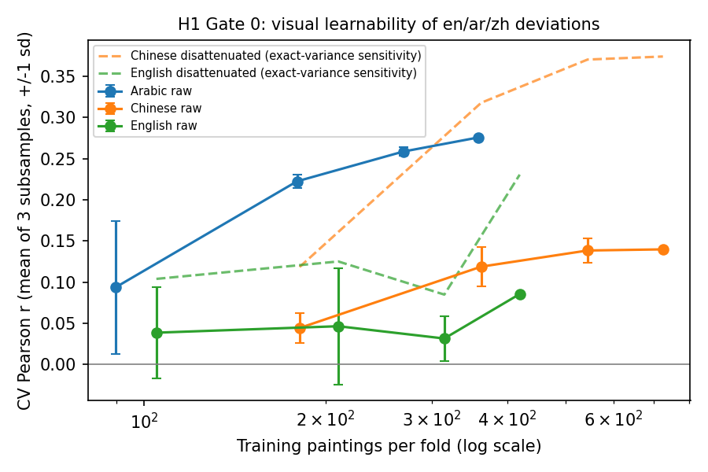

# H1 Gate 0 — do en/ar/zh cultural deviations inform the other 22 languages?

Analysis, not a competition experiment. CPU only, 2026-11-28. Official Train annotations only: Development unused, nothing external, no training run. Branch `codex/h1-gate0` (from `39adfa8`). Script `scripts/h1_gate0.py`, library `src/st3/h1_gate0.py`, tests `tests/test_h1_gate0.py`.

## Decision: STOP_H1

**STOP H1.** The pre-registered STOP rule fires on the oracle clause. Adding the *gold* en/ar/zh deviations to C2 lowers test-like Contrast. The oracle Δ over C2 is **−0.0143 [−0.0211, −0.0076]** on the 951 P2 paintings with at least one source. That is far below the +0.005 threshold. Analysis A also shows no transfer once the shared-reference artifact is removed. With disjoint references, the pooled raw r is **−0.009 [−0.020, +0.004]**.

The pre-registered disattenuation is undefined. The delta-method sampling variance makes every reliability negative at 5 votes. A labelled sensitivity uses the exact empirical-logit variance. It gives a disattenuated split-reference r of **+0.013 [−0.073, +0.088]**, so the A clause also says STOP. All four variants (shared/split reference × delta/exact variance) decide STOP_H1.

The en/ar/zh deviations are partly learnable from pixels, and the curve still rises with more paintings. They just do not carry information about the 22 scored languages. So ~51k ArtELingo en/ar/zh paintings would mostly teach a model about languages that Evaluation does not score. Runtime **299 s** on CPU.

## Population and inputs

| Item | Value |
| --- | --- |
| Train paintings / eligible pairs (≥5 binary-mappable votes) | 1,571 / 16,019 |
| Votes per pair | median 5, mean 5.12 (max 11) |
| Eligible paintings: English / Arabic / Chinese | 648 / 535 / 1,113 |
| Paintings with all three sources | 261 (212 of them in P2) |
| Targets | the 22 test-like languages |
| P2 (Analyses B, C) | 1,335 paintings, the five pinned painting-grouped folds of the EXP-038 overlay |
| C2 OOF and E1/E3 features | sealed EXP-038 run-4 results `b80e7cda…`, each member checked against its export manifest |
| Base manifest / overlay | `026720f4…` / `c3adc3b5…` (overlay manifest `b3303f03…`, P2 protocol `869b2fe2…`, pairs `50798dd…`) |
| Bootstrap | Analysis A 2,000 painting resamples, B 20,000 (the `compare` rule), seed 20261128 |

Run outputs (outside Git) are in `runs/h1_gate0/`:

| File | SHA-256 |
| --- | --- |
| `gate0.json` | `8351079371bac648ee712050517cfaa20c692a542a3da1552044796922be8251` |
| `analysis_a_shared.csv` | `8b875345…` |
| `analysis_a_split.csv` | `c22e4443…` |
| `analysis_a_shared_exact.csv` | `ec27404a…` |
| `analysis_a_split_exact.csv` | `c4119923…` |
| `analysis_c_curves.csv` | `18459565…` |

## A. Deviation correlation between source t and target l

Deviations are empirical logits centered on the painting's *other* eligible languages, excluding t and l, with at least three others. There are 49 (t, l) cells with ≥100 paintings, at most 879 paintings per cell.

- **Shared reference (pre-registered).** t and l are centered on the same mean. Under independence this mean injects a positive correlation of about 1/(m+1); the expected null r averaged over cells is **+0.090**.
- **Split reference (bias check).** The other languages are split into two disjoint halves, so the null is 0.

| Pooled r (95% CI) | English (16 cells) | Arabic (15) | Chinese (18) | All (49) |
| --- | --- | --- | --- | --- |
| Raw, shared reference | 0.105 [0.091, 0.120] | 0.126 [0.109, 0.144] | 0.111 [0.101, 0.121] | **0.113 [0.104, 0.122]** |
| Expected under independence, shared | | | | ≈ 0.090 |
| Raw, split reference | −0.002 [−0.021, 0.018] | −0.012 [−0.036, 0.013] | −0.011 [−0.026, 0.004] | **−0.009 [−0.020, 0.004]** |
| Disattenuated, delta variance (pre-registered) | undefined | undefined | undefined | **undefined** |
| Disattenuated, exact variance, shared | 0.58 [0.40, 0.94] | unstable | 0.66 [0.50, 0.98] | 0.64 [0.51, 0.84] |
| Disattenuated, exact variance, split | −0.003 [−0.148, 0.130] | unstable | 0.010 [−0.072, 0.119] | **0.013 [−0.073, 0.088]** |

**Why the pre-registered disattenuation is undefined.** Reliability = 1 − mean sampling variance / observed variance.

- The delta-method variance 1/(k+.5) + 1/(n−k+.5) has mean **1.37** per pair. At n = 5, k ∈ {0, 5} it is 2.18, while the empirical logit is bounded.
- That exceeds the observed variance of the deviations. Every source reliability is negative (mean −1.0, max −0.11), and target reliabilities are mostly negative (mean −0.6). No cell has both positive in either reference, so no cell enters the pool.

**Sensitivity (a labelled deviation from the pre-registration).** The exact variance of the corrected empirical logit under Binomial(n, (k+.5)/(n+1)) has mean **0.68**.

- Both reliabilities are positive in 40/49 split cells and 34/49 shared cells. They are typically **0.1–0.4**, so most of the per-painting deviation is vote noise.
- Disattenuating the shared reference inflates the artifact too: its shared component is "true" variance by construction, hence 0.64.
- The split-reference value is the interpretable one, and it is null.
- Arabic per-source pools are unstable: tiny positive reliabilities divide a near-zero r, giving a point estimate of 15 in one case. They are reported only as unstable.

## B. Oracle ceiling over C2 (P2 OOF, test-like languages)

Construction:

- **Features.** Gold en/ar/zh empirical logits are centered on the painting's mean C2 logit. No other-language gold is used. Missing sources are set to 0, with indicators.
- **Target.** The per-target-language residual: gold logit − C2 logit.
- **Fitting.** Ridge is fitted on the training folds only, with alpha by inner GroupKFold(3) over {0.1, 1, 10, 100, 1000}. Applying a map to a painting it was fitted on raises an error.
- **Control.** The same fit with only the indicators and intercept. Oracle − control isolates the value of the gold source *values*.

| Subset | Paintings | C2 Contrast | Oracle − C2 | Control − C2 | Oracle − control |
| --- | --- | --- | --- | --- | --- |
| (i) ≥1 source | 951 | 0.48076 | **−0.01431 [−0.02113, −0.00758]**, W/L 403/548 | −0.01266 [−0.01692, −0.00842] | −0.00165 [−0.00715, +0.00396] |
| (ii) all three | 212 | 0.46469 | **−0.02195 [−0.03907, −0.00485]**, W/L 87/125 | −0.01153 [−0.02127, −0.00179] | −0.01042 [−0.02380, +0.00319] |

The control is itself negative: re-fitting per-language residual intercepts on noisy empirical logits damages C2's within-painting pattern. Still, the clean comparison (oracle − control) shows that the gold source values add **nothing**: the point estimates are negative and the CIs include 0. The pre-registered quantity is oracle − C2 for (i), −0.0143 < +0.005, so **STOP**.

## C. Visual learnability of the source deviations (E3 + E1, ridge, P2 folds)

Each source's deviation is centered on all its other eligible languages. It is predicted from L2-normalized E3 (Qwen3-VL-Embedding-2B) ⊕ E1 (SigLIP2 So400m) with RidgeCV (11 alphas, 0.1–10⁴). The models train on 25/50/75/100% of each training fold with three seeded subsamples; at 100% the subsample is the whole fold, so the sd is 0.

| Source | Paintings | Mean train N per fold | CV r by fraction (25 / 50 / 75 / 100%) | Slope of r per log N | Reliability (delta / exact) | r at 100%, disattenuated (exact) |
| --- | --- | --- | --- | --- | --- | --- |
| English | 524 | 105 → 419 | 0.039 / 0.046 / 0.031 / 0.086 | **+0.023** | −0.66 / 0.14 | 0.23 |
| Arabic | 448 | 90 → 358 | 0.093 / 0.222 / 0.259 / 0.276 | **+0.134** | −1.80 / −0.06 | undefined |
| Chinese | 905 | 181 → 724 | 0.044 / 0.119 / 0.138 / 0.140 | **+0.072** | −0.65 / 0.14 | 0.37 |

All three slopes are positive, so the PROMISING slope criterion (≥2 positive) would have been met. The Arabic deviation is the most predictable (r 0.28) even though its estimated reliability is ≤0. The binomial-noise model therefore misdescribes the Arabic votes, so the Arabic reliability should not be trusted.

## Decision trace

| Variant | A clause (CI includes 0 and r < 0.10) | B clause (oracle Δ < +0.005) | Decision |
| --- | --- | --- | --- |
| Shared reference, delta variance (pre-registered) | not evaluable | true | **STOP_H1** |
| Split reference, delta variance | not evaluable | true | STOP_H1 |
| Shared reference, exact variance | false | true | STOP_H1 |
| Split reference, exact variance | true | true | STOP_H1 |

## Limitations

- **5-vote noise.** Most pairs have exactly five votes (90.3% of P2 pairs). Per-painting deviations are mostly sampling noise (exact-variance reliabilities 0.1–0.4), which attenuates A and B. B is an upper-bound *proxy*: H1 would predict these deviations from pixels, which is noisier still, not observe them.
- **Few paintings with all sources.** Only 261 training paintings (212 in P2) have all three; subset (ii) has wide CIs.
- **Reliability model.** The pre-registered delta-method variance is unusable at n = 5. The exact-variance sensitivity uses a plug-in p from the same counts, and it still gives a negative Arabic reliability, so the binomial model is imperfect (Arabic votes may be under-dispersed or dependent).
- **Oracle construction.** Per-language residual intercepts refitted on empirical logits hurt C2 on their own, which is why the control is reported. The oracle − control difference is the cleanest estimate and is ≤0.
- **Annotator pools (unverified).** ArtELingo's en/ar/zh annotators may differ from ArtEmotion-28's. The organizers say the original release contains these languages' annotations for these paintings, so they are likely the same pool, but this is unverified.
- **Scope.** This tests linear transfer from gold source deviations into C2's residual and linear ridge learnability on frozen features. It does not rule out other uses of ArtELingo, such as pretraining a general emotion representation. Whether ArtELingo is allowed at all remains pending (organizer issue #2).
